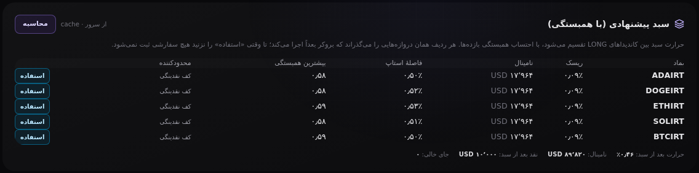

# A3 — تخصیص سبد با احتساب همبستگی

تاریخ: ۲۰۲۶-۱۰-۲۰ · وضعیت: **پذیرفته — پیاده‌شده**

## مسئله

تابلوی سیگنال می‌تواند هم‌زمان هشت LONG نشان بدهد. اگر هر کدام را مثل
«تنها معاملهٔ حساب» سایز کنیم — ۰٫۷۵٪ ریسک هر یک — کل بودجهٔ حرارت صرف
چیزی می‌شود که ممکن است **یک معامله** باشد: آلت‌کوین‌ها با هم بالا و پایین
می‌روند. هشت پوزیشن «مستقل» می‌تواند یک شرط متمرکز باشد با هشت تیکر.

## تصمیم

`server/portfolio.py` بودجهٔ حرارت را بین کاندیداها تقسیم می‌کند و بعد همان
دروازه‌های بروکر را روی نتیجه اجرا می‌کند.

### روش، بی‌مبهم

1. بازده لگاریتمی هر نماد از کندل‌ها، **روی تایم‌استمپ‌های مشترک**. همبستگی
   دو سری با شکاف‌های متفاوت، تقویم را می‌سنجد نه بازار.
2. ماتریس همبستگی نمونه، شرینک‌شده به سمت استقلال (`shrinkage`، پیش‌فرض ۰٫۳۰):
   یک ماتریس ۸×۸ از چند صد کندل عمدتاً نویز است و برآورد بالا باعث می‌شود
   تخصیص‌دهنده تنوعی را که نمی‌بیند حذف کند.
3. وزن‌های **ERC** (سهم برابر از ریسک): هر کاندیدا سهم یکسانی از واریانس سبد
   می‌گذارد. این همان چیزی است که دو آلت همبسته را وادار می‌کند یک شرط را
   نصف کنند نه دو برابر.
4. آبشار روی محدودیت‌های واقعی حساب: سقف ریسک هر معامله، سقف تک‌دارایی ۲۵٪
   (که با فاصلهٔ استاپ به ریسک ترجمه می‌شود)، بودجهٔ حرارت، کف نقدینگی.
5. `risk_engine.preflight` روی بازمانده‌ها، به ترتیب نزولی حجم: هر چه بروکر
   رد می‌کرد حذف می‌شود و **نام دروازه** همراه ردیف می‌آید.

هیچ‌جا عدد حدسی ساخته نمی‌شود: جفتی که تاریخچهٔ مشترک کافی ندارد
`corr = null` می‌گیرد نه صفر؛ نمادی که استاپ یا کندل ندارد با دلیل کنار
گذاشته می‌شود؛ اگر تابلوی سیگنال هیچ LONG نداشته باشد، پاسخ «چیزی برای
تخصیص نیست» است، نه یک سبد ساختگی.

### قرارداد روت

`POST /api/portfolio/allocate` — بدنه: `{tf?, lookback?, limit?, symbols?, shrinkage?}`

- `ok:true` ⇒ `method, shrinkage, budget_pct, allocations[], dropped[], totals{}, correlation{symbols,values,missing}, vol{}, candles_from[], tf, lookback, source, as_of`
- هر ردیف: `symbol, entry, stop, stop_pct, risk_pct, notional_usd, fee_usd, qty, notional_quote, fx, quote, score, vol, corr_max, risk_share_pct, bound_by, gates[]`
- `bound_by` می‌گوید چه چیزی جلوی بزرگ‌تر شدن را گرفت: `erc-share` (وزن
  همبستگی)، `single-asset-cap`، `per-trade-cap`، `cash` (کف نقدینگی).
- کلید سوئیچ مسلح ⇒ `{ok:false, blocked:true, blocked_by:"halted"}` — همان
  رفتار whatif.

**هیچ stateای تغییر نمی‌کند** (تست `test_route_does_not_move_the_account`).

## فرانت

کارت «سبد پیشنهادی (با همبستگی)» در تب desk: نماد، ریسک، نامینال، فاصلهٔ
استاپ، بیشترین همبستگی، محدودکننده، و دکمهٔ **استفاده**. دکمه، اندازه و استاپ
همان ردیف را در بلیت می‌گذارد و پیش‌نمایش whatif را دوباره صدا می‌زند — یعنی
تخصیص از «نمایش» به «تصمیم» می‌رسد، نه اینکه فقط زیبا باشد.

## شاهد

- `pytest -q server/tests` ⇒ **۱۶۷ passed** (۲۵ تست تازه در `test_portfolio.py`).
- تست‌های ریاضی، دستی محاسبه شده‌اند: همبستگی پیرسون، None برای نمونهٔ ناکافی،
  هم‌ترازی تایم‌استمپ، برابری سهم ریسک در ERC، وزن کمتر برای نماد پرنوسان،
  سقف تک‌دارایی (۲۵٪ ⇒ ۲۵٬۰۰۰ دلار با استاپ ۰٫۵٪)، کف نقدینگی، پرشدن اسلات‌ها،
  سوئیچ مسلح، نماد بدون تاریخچه.
- روی فیکسچر (`:8022`): پنج کاندیدای LONG، هر یک ۱۷٬۹۶۴ دلار نامینال
  (مجموع ۸۹٬۸۲۰ = سقف نقد)، حرارت بعد از سبد ۰٫۴۶٪، نقد باقی‌مانده ۱۰٬۰۰۰
  (دقیقاً کف)، همبستگی ۰٫۵۷–۰٫۵۹ بین آلت‌ها.
- `probe_live --url :8022` ⇒ PASS ۴۵ پنل (exit 0).

## دو باگی که در همین مسیر پیدا شد

1. **سایه‌افتادن روی `renderAlloc`:** صفحه از قبل تابعی به همین نام برای
   قوس‌های دفتر کاغذی داشت. تابع تازهٔ من آن را در scope سراسری می‌پوشاند و
   حلقهٔ قوس‌ها بی‌صدا خالی می‌ماند. همهٔ نام‌ها با پیشوند `book*` تغییر کردند
   و رندر قوس‌ها دوباره تست شد.
2. **فهرست نمادهای بلیت ساختگی بود:** `symbols` شامل `XYZIRT` (نمادی که وجود
   ندارد) و `ETHUSDT` بود ولی `ETHIRT` در آن نبود؛ یعنی تخصیص می‌توانست
   نمادی را در بلیت بگذارد که در dropdown نیست. حالا فهرست از `universe` زنده
   ساخته می‌شود (۶ جفت IRT فیکسچر)، و اگر نمادی هنوز در dropdown نباشد،
   «استفاده» خودش آن را اضافه می‌کند.

## محدودیت‌های آگاهانه

- وقتی فاصلهٔ استاپ همهٔ کاندیداها کوچک باشد، **سقف تک‌دارایی** زودتر از بودجهٔ
  ریسک بسته می‌شود: هر نماد ۲۵٪ نامینال می‌گیرد و سبد عملاً برابر-وزن می‌شود.
  این عیب نیست، نتیجهٔ قواعد فعلی است؛ ستون «محدودکننده» همین را نشان می‌دهد.
- ERC بر واریانس بازده تمرکز دارد، نه بر بتا؛ اثر همبستگی روی **جهت** سیگنال
  لحاظ نمی‌شود (همهٔ کاندیداها LONG هستند).
- ریسک همبستگیِ باقی‌ماندهٔ دنباله (tail) در ماتریس نیست.
