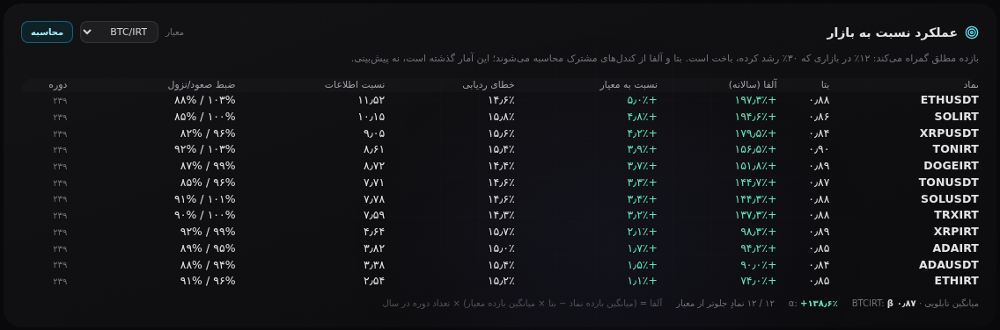
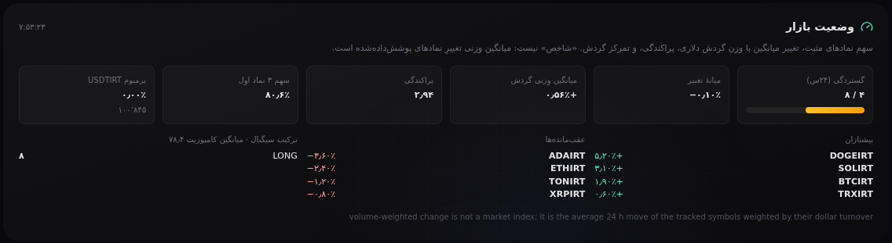

# A7 و A6 — عملکرد نسبت به معیار، و وضعیت بازار

تاریخ: ۲۰۲۶-۱۰-۲۰ · وضعیت: **پذیرفته — پیاده‌شده**

---

## A7 — بتا و آلفا نسبت به معیار

### مسئله

بازده مطلق به سؤال اشتباه جواب می‌دهد. آلت‌کوینی که ۱۲٪ رشد کرده در بازاری که
۳۰٪ رشد کرده **باخته**؛ ماهی که صفر بوده در بازاری که ۲۰٪ ریخته، ماه خوبی بوده.
تابلو فقط عدد مطلق را می‌گفت.

### روش (همان که در کد است)

```
r_i, r_b   بازده لگاریتمی روی کندل‌های مشترک
beta       cov(r_i, r_b) / var(r_b)
alpha      (mean(r_i) − beta·mean(r_b)) · P        سالانه، درصد
TE         stdev(r_i − r_b) · √P
IR         mean(r_i − r_b) · P / TE
capture    mean(r_i | r_b>0) / mean(r_b | r_b>0)   و سمت نزول
```

`P` تعداد کندل در سال است و **۳۶۵ روز** گرفته شده، نه ۲۵۲ روزِ متعارف سهام:
بازار کریپتو ۲۴/۷ است و ۲۵۲ آلفا را حدود ۴۵٪ بیش از واقع نشان می‌دهد.

### قرارداد

`POST /api/benchmark/relative` — `{tf?, bench?, lookback?, symbols?}`

- `rows[]`: `symbol, n, beta, corr, alpha_annual_pct, excess_annual_pct,
  tracking_error_pct, info_ratio, up_capture_pct, down_capture_pct,
  asset_return_pct, bench_return_pct, relative_return_pct, direction, composite`
- `summary`: میانگین تابلویی + چند نماد از معیار جلوترند
- نماد با کمتر از ۳۰ کندل مشترک ⇒ در `dropped` با دلیل، نه بتای ساختگی.
- معیار نامعلوم ⇒ `ok:false` با متن، نه سکوت.

### دو استثنا که عمداً گذاشته شد

- **USDT/IRT** یک جفت ارزی است، نه دارایی؛ «آلفای تتر نسبت به بیت‌کوین» نویز است.
- **BTC/USDT در برابر BTC/IRT** بیس تومان/دلار را می‌سنجد، نه عملکرد بیت‌کوین.
  هر دو اگر **با نام** خواسته شوند باز هم برمی‌گردند.

### UI

کارت «عملکرد نسبت به بازار» در تب performance: جدول بتا/آلفا/نسبت به معیار/
خطای ردیابی/نسبت اطلاعات/ضبط صعود و نزول، با انتخاب معیار و میانگین تابلویی.

---

## A6 — وضعیت بازار

### تصمیم اصلی: «شاخص» نمی‌سازیم

شاخص بازار به وزن سرمایه‌ای هر دارایی نیاز دارد و ما آن را نداریم. عددی که
«شاخص» نام بگیرد ولی میانگین وزنیِ هشت نماد باشد، همان چیزی است که این پروژه
یک بار از آن ضربه خورد. پس کارت دقیقاً می‌گوید چه چیزی است:

- **گستردگی:** چند نماد از چند نماد مثبت است (و همان، وزن‌دار با گردش دلاری).
- **تغییر:** میانه، میانگین ساده، و **میانگین وزنی گردش** — با این جمله در
  پایین کارت که «شاخص نیست».
- **پراکندگی:** انحراف معیار تغییرها؛ بازارِ دو دسته را از بازارِ یکدست جدا می‌کند.
- **تمرکز:** سهم سه نماد اول از گردش، به دلار.

### سه دام واحد که همه‌شان باگ واقعی بودند

1. **گردش IRT + گردش USDT جمع‌شدنی نیست.** حجم هر جفت به ارز مظنهٔ خودش است؛
   جمع خام آن‌ها تومان را به دلار اضافه می‌کند و جفت‌های IRT (که ~۱۰۰٬۰۰۰×
   بزرگ‌ترند) همه‌چیز را می‌بلعند. اکنون هر ردیف `fx_usd` می‌گیرد و به دلار
   تبدیل می‌شود.
2. **USDT/IRT معیار بازار نیست، نرخ ارز است.** در گستردگی شمرده نمی‌شد
   (میانه را به صفر می‌کشید) و جداگانه به‌عنوان `fx` گزارش می‌شود.
3. **یک دارایی، دو مظنه.** BTC/IRT و BTC/USDT یک دارایی‌اند؛ شمردن هر دو،
   بیت‌کوین را دو برابر وزن می‌داد و «۸ دارایی» را «۱۷ نماد» نشان می‌داد.
   `excluded.same_asset` می‌گوید چند ردیف به همین دلیل کنار گذاشته شد.

### فیکسچر هم عوض شد

`mock_upstream.py` حجم را `1e12 / (i + 3)` می‌داد **در ارز مظنهٔ هر جفت** —
یعنی یک جفت USDT روزی ۳۰۰ میلیارد دلار گردش ادعا می‌کرد و ۹۹٬۹۹٪ سبد را
می‌گرفت. اکنون گردش در **دلار** تعریف می‌شود (`TURNOVER_USD`) و به ارز مظنه
تبدیل می‌گردد؛ تغییر ۲۴ساعته هم هر نماد مقدار خودش را دارد تا گستردگی
همیشه ۰٪ یا ۱۰۰٪ نباشد. جفت‌های USDT هم به فهرست اضافه شدند تا پرمیوم
USDTIRT یک پا نداشته باشد — پیش از این `premium: None` بود.

---

## شاهد





- `pytest -q server/tests` ⇒ **۱۹۶ passed** (۱۳ تست `test_benchmark.py`،
  ۱۵ تست `test_market_overview.py`).
- روی فیکسچر (`:8022`):
  - A7: β برای SOLIRT ۰٫۸۷، آلفا +۱۳۸٫۶٪ (سالانه، روی ۳۹۹ کندل ۱ساعته)،
    ۱۲ از ۱۲ نماد از BTC جلوتر. **این عددها را باید به‌عنوان آمار سری
    ساختگی خواند، نه ادعای عملکرد.**
  - A6: گستردگی ۴/۸، میانه −۰٫۱۰٪، میانگین وزنی +۰٫۵۶٪، پراکندگی ۲٫۹۴،
    تمرکز ۸۰٫۶٪، نرخ USDTIRT ۱۰۰٬۸۰۵، ترکیب سیگنال ۸ LONG.
- ۰ خطای صفحه در هر دو تب.

## محدودیت‌های آگاهانه

- آلفا روی کندل‌های **گذشته** است و پیش‌بینی نیست؛ کارت همین را می‌نویسد.
- «دامیننس تتر» در A6 محاسبه نشد: برای آن به ارزش کل بازار نیاز است که در
  دسترس نیست. به‌جایش تمرکز گردش گزارش می‌شود که همان داده را دارد.
- بتا وزن پوزیشن‌ها را در نظر نمی‌گیرد؛ این کار تخصیص‌دهنده (A3) است.
